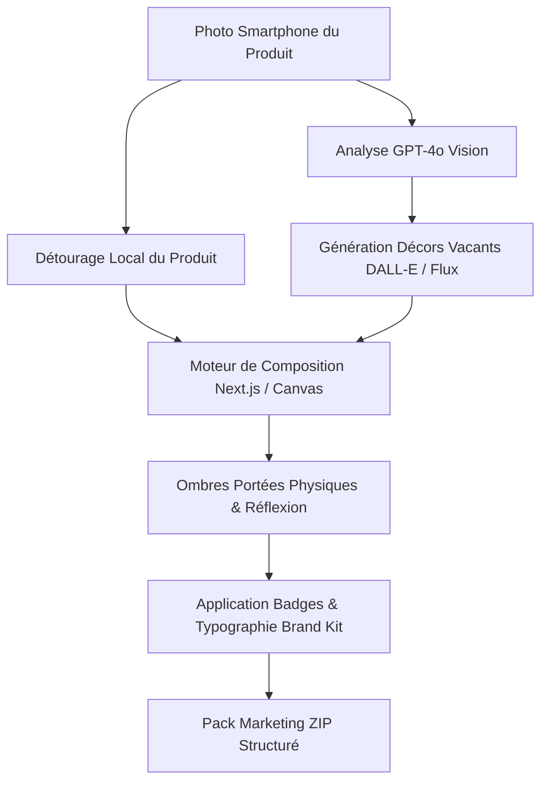

# 🌟 MarkMosaiq — AI Content & Product Staging Studio pour l'E-Commerce en Tunisie

[](https://nextjs.org/)
[](https://react.dev/)
[](https://www.typescriptlang.org/)
[](https://supabase.com/)
[]()

> **MarkMosaiq** est la plateforme SaaS d'IA de nouvelle génération conçue spécifiquement pour les commerçants, revendeurs et agences e-commerce en Tunisie.  
> Transformez une simple photo de produit prise au smartphone en un **Pack Marketing Complet de 20 à 25 visuels prêts à publier** (Feed Instagram, Stories 9:16, publicités Facebook/TikTok Ads et accroches Darija haute conversion).

---

## 📑 Sommaire

1. [La Thèse Commerciale](#-la-thèse-commerciale)
2. [Fonctionnalités Principales](#-fonctionnalités-principales)
3. [Architecture & Pipeline IA (Zero-Hallucination)](#-architecture--pipeline-ia-zero-hallucination)
4. [Standards E-Commerce Tunisie](#-standards-e-commerce-tunisie)
5. [Structure du Projet](#-structure-du-projet)
6. [Installation & Démarrage](#-installation--démarrage)
7. [Variables d'Environnement](#-variables-denvironnement)
8. [Modèle Économique & Tarifs](#-modèle-économique--tarifs)
9. [Documentation Connexe](#-documentation-connexe)

---

## 🎯 La Thèse Commerciale

Vendre de simples "crédits d'images brutes" à des commerçants présente 3 verrous majeurs :
1. **Le syndrome de la page blanche** : Le commerçant ne sait pas quel prompt formuler pour obtenir un rendu commercial.
2. **La déformation de marque** : Une IA générative pure réinvente les étiquettes, logos et textes des produits réels.
3. **Une faible valeur perçue** : 20 crédits d'images ressemblent à un gadget. En revanche, un **Pack de Lancement Clé en Main** prêt pour Facebook Ads, Instagram et WhatsApp a une valeur perçue de **150 à 300 DT** par rapport à un shooting studio ou une prestation graphique.

**La solution MarkMosaiq** : Vendre des packs structurés clé en main où le produit d'origine est **100% préservé**, avec un détourage net, des ombres portées réalistes et des badges de conversion adaptés au marché local.

---

## 🚀 Fonctionnalités Principales

### 1. 🎨 Studio de Mise en Scène & Composition Interactif (`/studio`)
- **Préservation physique du produit** : Le produit réel est détouré et posé sur un arrière-plan généré sans déformation.
- **Moteur d'ombres relatives** : Occlusion ambiante sous la base du produit et ombre directionnelle projetée adaptée à l'éclairage de la scène.
- **Formats multi-plateformes** : Bascule instantanée entre **Feed (1:1)** et **Stories / Reels (9:16)** avec respect des zones de sécurité Instagram (safe zones 14%–80%).
- **Badges de réassurance locaux** : *"Livraison 24-48h sur 24 gouvernorats"*, *"Paiement à la livraison"*, *"100% Authentique"*, *"Stock Limité"*.

### 2. 🛡️ Brand Kit Multi-Tenant avec Extracteur Automatique (`/brand-kit`)
- **Extracteur de couleurs de logo par échantillonnage pixel (Canvas)** : Analyse instantanée du logo (PNG, SVG, JPG, Base64) pour extraire la couleur primaire (CTA), secondaire (badges) et d'accentuation.
- **Harmonie typographique** : Prise en charge des polices premium *Outfit* et *Plus Jakarta Sans*.
- **Catalogue produits intégré** : Enregistrement des fiches produits, prix en USD et descriptions associées.
- **Extraction automatique IA via URL / Instagram** : Importation de l'identité visuelle et du positionnement de marque en un clic via GPT-4o.

### 3. 🇹🇳 Copywriting Darija & Accroches E-Commerce Haute Conversion
- Génération de textes de publication et légendes Instagram en Darija tunisienne authentique :
  - *"Khlas and el livrison"* (Paiement à la livraison).
  - *"Livri fisaa fi tounes el kol (24-48h)"* (Livraison rapide).
  - *"Weslet el commande fi boutique mteena !"* (Nouveau stock).
  - *"Abathna message bech treservi pot mteeek !"* (Appel à l'action DM).

### 4. 🏢 Architecture Multi-Workspaces
- Sélecteur de workspace instantané (`<WorkspaceSelector />`) dans l'AppShell.
- Espaces de travail étanches par boutique ou par client d'agence (ex: *NutriStore Tunisie*, *Vestiaire Tunis*).

### 5. 💳 Passerelles de Paiement & Facturation B2B Locale (`/checkout` & `/pricing`)
- Intégration des moyens de paiement tunisiens : **Flouci**, **Konnect**, et **ClickToPay / GPG**.
- Génération de factures proforma et devis téléchargeables pour les règlements par virement et chèque bancaire.

### 6. 📦 Export ZIP Prêt à Poster
- Téléchargement en 1 clic d'une archive `.zip` structurée comprenant visuels haute résolution, stories déclinées et fichier de légendes `copywriting_instagram.txt`.

---

## 🧠 Architecture & Pipeline IA (Zero-Hallucination)



### Le Protocole Zéro-Hallucination
1. **Prompts strictement positifs** : Ne jamais utiliser de mots négatifs (*"no bottles, without objects"*). Toujours décrire l'espace vide positivement :  
   `"The central pedestal top surface is completely vacant, pristine, smooth and polished, cleanly awaiting an object."`
2. **Incrustation nette** : Le produit du commerçant n'est jamais redessiné par l'IA.
3. **Physique des ombres** :
   - *Contact Blur* : $W_{\text{produit}} \times 0.035$ (Occlusion ambiante sous la base).
   - *Cast Shadow* : Projetée à l'opposé de la source lumineuse principale.

---

## 🇹🇳 Standards E-Commerce Tunisie

- **Géographie stricte** : Prise en charge exclusive des **24 Gouvernorats** de Tunisie (Tunis, Ariana, Ben Arous, Manouba, Nabeul, Zaghouan, Bizerte, Béja, Jendouba, Le Kef, Siliana, Sousse, Monastir, Mahdia, Sfax, Kairouan, Kasserine, Sidi Bouzid, Gabès, Médenine, Tataouine, Gafsa, Tozeur, Kébili).
- **Monnaie & Tarification** : Tous les prix sont affichés en **DT** ou **USD** (ex: `29 DT`, `59 DT`, `189 DT`).
- **Livraison & Réassurance** : Mentions adaptées au contexte commercial local (paiement à la livraison, délais 24-48h).

---

## 📂 Structure du Projet

```
MarkMosaiq/
├── docs/                                  # Spécifications et plans stratégiques
│   ├── PLAN_STRATEGIQUE_MarkMosaiq.md          # Thèse commerciale, coûts API & marges
│   ├── PROMPT_ENGINEERING_ARCHITECTURE.md # Règles DALL-E 3, safe zones et ombres
│   └── PLAN_BIBLIOTHEQUE_INSPIRATION.md   # Bibliothèque de décors et presets
├── public/                                # Assets statiques, badges SVG & démos
│   ├── badges/                            # Badges marketing (Livraison 24h, 100% Original)
│   └── images/                            # Logos et visuels studio
├── src/
│   ├── actions/                           # Server Actions Next.js (Supabase & Brand Kit)
│   │   ├── brandkit.actions.ts
│   │   └── product.actions.ts
│   ├── app/                               # Next.js 16 App Router
│   │   ├── api/                           # Route Handlers API
│   │   │   ├── brand-kit/                 # GET/POST Brand Kit
│   │   │   ├── brand-kit/extract/         # Extraction IA par URL
│   │   │   └── products/                  # CRUD Catalogue produits
│   │   ├── brand-kit/                     # Page Gestion du Brand Kit
│   │   ├── checkout/                      # Page Paiement & Passerelles locales
│   │   ├── pricing/                       # Grille Tarifaire des Packs
│   │   ├── studio/                        # Studio interactif de staging
│   │   ├── layout.tsx                     # Layout racine avec AppShell
│   │   ├── globals.css                    # Design tokens & variables CSS
│   │   └── page.tsx                       # Landing Page officielle
│   ├── components/                        # Composants UI réutilisables
│   │   ├── AppShell.tsx                   # Navbar responsive & Sidebar rétractable
│   │   ├── BrandKitModal.tsx              # Modale de configuration rapide
│   │   └── WorkspaceSelector.tsx          # Sélecteur multi-tenant
│   └── lib/                               # Utilitaires & logique métier
│       ├── brandkit.ts                    # Modèles TypeScript & données par défaut
│       ├── colorExtractor.ts              # Échantillonneur de palette Canvas
│       ├── supabase.ts                    # Client Supabase
│       └── WorkspaceContext.tsx           # Contexte React Multi-Workspace
├── supabase/
│   └── migrations/                        # Schéma SQL et tables de base de données
├── AGENTS.md                              # Constitution technique et règles d'ingénierie
├── package.json
└── tsconfig.json
```

---

## 💻 Installation & Démarrage

### Prérequis
- **Node.js** : version 18.18+ ou 20+
- **npm**, **pnpm** ou **yarn**

### 1. Cloner le projet et installer les dépendances
```bash
git clone <url-du-repo>
cd MarkMosaiq
npm install
```

### 2. Démarrer le serveur de développement
```bash
npm run dev
```
L'application démarre par défaut sur [http://localhost:3001](http://localhost:3001).

### 3. Compiler pour la production
```bash
npm run build
npm run start
```

---

## 🔐 Variables d'Environnement

Créez un fichier `.env.local` à la racine du projet avec les clés suivantes :

```env
# Supabase Configuration
NEXT_PUBLIC_SUPABASE_URL=https://votre-projet.supabase.co
NEXT_PUBLIC_SUPABASE_ANON_KEY=votre-cle-anon-publique
SUPABASE_SERVICE_ROLE_KEY=votre-cle-service-role

# OpenAI API (Pour la génération de décors et l'analyse GPT-4o)
OPENAI_API_KEY=sk-...

# Passerelles de paiement tunisiennes (Optionnel selon environnement)
FLOUCI_APP_TOKEN=...
FLOUCI_APP_SECRET=...
KONNECT_API_KEY=...
```

---

## 💰 Modèle Économique & Tarifs

| Pack | Visuels Inclus | Prix Public | Coût de Revient API | Marge Brute |
| :--- | :--- | :--- | :--- | :--- |
| **Pack Flash** | 10 visuels (1 produit) | **29 DT** | ~1,30 DT | **95,5%** |
| **Pack Pro Lancement** | 20 visuels complets (Feed + Stories + Ads) | **59 DT** | ~3,16 DT | **94,6%** |
| **Abonnement Starter** | 50 visuels / mois | **49 DT / mois** | ~7,50 DT | **84,7%** |
| **Abonnement Agence** | 300 visuels / mois (Multi-marques) | **299 DT / mois** | ~45,00 DT | **85,0%** |

---

## 📚 Documentation Connexe

- [AGENTS.md](file:///c:/Users/MEDIA%20INFOPLUS/.gemini/antigravity-ide/scratch/MarkMosaiq/AGENTS.md) : Constitution technique, protocole cognitif et standards de code.
- [docs/PLAN_STRATEGIQUE_MarkMosaiq.md](file:///c:/Users/MEDIA%20INFOPLUS/.gemini/antigravity-ide/scratch/MarkMosaiq/docs/PLAN_STRATEGIQUE_MarkMosaiq.md) : Plan stratégique et analyse financière détaillée.
- [docs/PROMPT_ENGINEERING_ARCHITECTURE.md](file:///c:/Users/MEDIA%20INFOPLUS/.gemini/antigravity-ide/scratch/MarkMosaiq/docs/PROMPT_ENGINEERING_ARCHITECTURE.md) : Spécifications des prompts et des ombres portées.
- [docs/PLAN_BIBLIOTHEQUE_INSPIRATION.md](file:///c:/Users/MEDIA%20INFOPLUS/.gemini/antigravity-ide/scratch/MarkMosaiq/docs/PLAN_BIBLIOTHEQUE_INSPIRATION.md) : Architecture de la bibliothèque de décors.

---

© 2026 **MarkMosaiq SaaS** — Développé avec passion pour l'écosystème E-Commerce en Tunisie.
