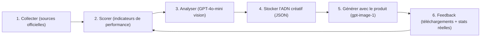
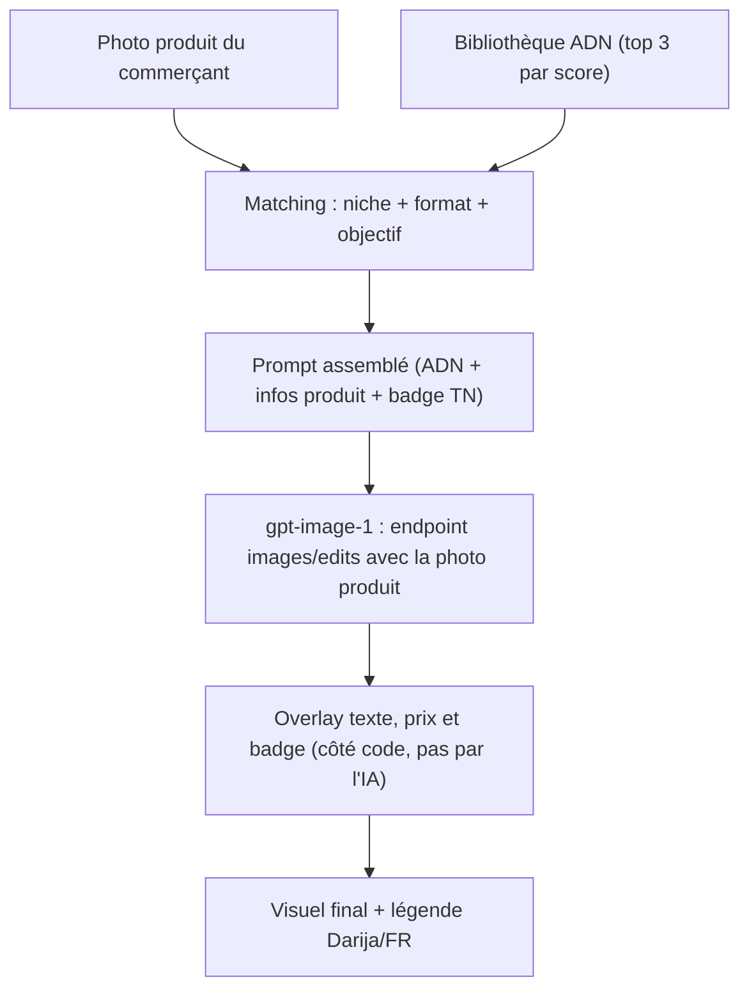

# 🧠 Plan — Bibliothèque d'Inspiration « Visuels qui performent » pour MarkMosaiq

## 1. L'idée en une phrase

On ne **copie pas** des images virales : on en extrait l'**ADN créatif** (composition, lumière, accroche, couleurs, mise en page) et on l'applique au **produit réel** du commerçant.



---

## 2. Où trouver les visuels à forte performance

### A. Sources officielles et gratuites (à utiliser en priorité)

| Source | Ce qu'on y trouve | Indicateur de performance disponible | Atout pour la Tunisie |
| :--- | :--- | :--- | :--- |
| **Meta Ad Library** (facebook.com/ads/library) | Toutes les pubs actives sur Facebook et Instagram | Pas de likes affichés → on utilise la **durée de diffusion** et le **nombre de variantes** | Filtre pays = **Tunisie** → vrais exemples locaux (COD, livraison 58 gouv.) |
| **TikTok Creative Center** → *Top Ads* | Les pubs TikTok les plus performantes par secteur et par pays | **CTR, likes, budget estimé, rétention** | Filtre par région MENA / France |
| **TikTok Creative Center** → *Trends* | Hashtags, sons et formats qui montent | Volume et croissance | Repérer les tendances avant qu'elles saturent |
| **Pinterest Trends** + Pinterest Predicts | Esthétiques et requêtes en hausse | Volume de recherche | Parfait pour mode, déco, beauté |
| **Google Trends** | Saisonnalité (Ramadan, Aïd, rentrée, soldes) | Intérêt de recherche | Planifier le calendrier des packs |
| **Instagram/TikTok publics** (consultation manuelle) | Posts organiques à fort engagement | Likes, commentaires, vues visibles | Curation manuelle uniquement (pas de scraping) |

> [!TIP]
> **Règle d'or Meta Ad Library :** une pub qui tourne depuis **plus de 30 jours** avec **plusieurs variantes** est presque toujours rentable. Personne ne paie longtemps pour une pub qui ne vend pas.

### B. Outils payants d'espionnage publicitaire (optionnels, pour aller plus vite)

| Outil | Points forts |
| :--- | :--- |
| **Foreplay** | Swipe files de pubs, organisation par marque et par format |
| **Minea** / **Dropispy** (français) | Pubs e-commerce, très orientées dropshipping, filtres par pays |
| **BigSpy** / **PowerAdSpy** | Multi-plateformes, filtres par engagement |
| **Kalodata** / **FastMoss** | Produits et créas TikTok Shop les plus vendeurs |

> [!NOTE]
> Vérifiez les tarifs et les conditions d'utilisation de chaque outil : ils changent souvent. Commencez gratuitement avec Meta et TikTok.

---

## 3. Scorer la performance (score MarkMosaiq sur 100)

Comme chaque plateforme expose des métriques différentes, on normalise :

| Critère | Poids | Source |
| :--- | :--- | :--- |
| Durée de diffusion (> 30 j = max) | 30 % | Meta Ad Library |
| Ratio engagement (likes + commentaires) / vues | 25 % | TikTok / organique |
| Nombre de variantes de la même pub | 15 % | Meta Ad Library |
| Commentaires d'intention d'achat (« prix ? », « dispo ? ») | 15 % | Lecture manuelle |
| Pertinence pour le marché tunisien | 15 % | Jugement du curateur |

**Seuil d'entrée dans la bibliothèque : score ≥ 70.**

---

## 4. Extraire l'« ADN créatif » (la clé du système)

Chaque visuel retenu passe **une seule fois** dans GPT-4o-mini en mode vision `detail: "low"` (~85 tokens d'image). On obtient un JSON réutilisable à l'infini :

```json
{
  "id": "beauty_serum_marble_001",
  "niche": "beaute",
  "format": "story_9x16",
  "score": 84,
  "composition": "produit centré, 2/3 bas, espace vide en haut pour le titre",
  "lighting": "lumière naturelle latérale chaude, ombres douces",
  "background": "marbre blanc, branches d'olivier floues",
  "palette": ["#F5EFE6", "#C9A27E", "#2E2A26"],
  "hook_type": "avant/après",
  "text_layout": "titre gras en haut, prix dans une pastille en bas à droite",
  "cta": "Commandez en DM",
  "emotion": "luxe accessible, naturel",
  "why_it_works": "contraste produit/fond fort, preuve sociale visible"
}
```

> [!IMPORTANT]
> On stocke **uniquement ce JSON**, pas l'image d'origine. Aucune marque, aucun logo ni visage de tiers ne passe dans la génération.

---

## 5. Pipeline de génération avec inspiration



Points techniques importants :

1. **`/v1/images/edits` plutôt que `/generations`** : on envoie la vraie photo du produit comme image de référence, ce qui réduit fortement la déformation des étiquettes.
2. **Le texte (prix, badge, CTA) est ajouté par le code** (Canvas / Sharp), jamais par l'IA → zéro faute d'orthographe, prix exact en DT.
3. **Économie de tokens** : l'analyse de l'ADN se fait une fois par référence. À la génération, on n'envoie que ~150 tokens de prompt assemblé.

### Nouvelles routes Next.js à créer

| Route | Rôle |
| :--- | :--- |
| `POST /api/inspiration/analyze` | Admin : image de référence + métriques → ADN JSON + score |
| `GET /api/inspiration?niche=&format=` | Renvoie les meilleurs ADN pour une niche et un format |
| `POST /api/generate-image` (mise à jour) | Accepte `inspirationId` + photo produit → `images/edits` |
| `POST /api/feedback` | Enregistre téléchargements, régénérations et stats réelles |

### Nouvelles pages

| Page | Rôle |
| :--- | :--- |
| `/admin/inspiration` | Ajouter une référence (upload + URL source + métriques), voir l'ADN extrait |
| `/generate` (mise à jour) | Sélecteur « S'inspirer de » avec cartes ADN (palette, type d'accroche, score) |

---

## 6. Boucle de feedback (ce qui rend le système meilleur chaque semaine)

| Signal | Comment le capter | Effet |
| :--- | :--- | :--- |
| Visuel téléchargé | Clic sur « Télécharger » | +1 au score de l'ADN utilisé |
| Visuel régénéré | Clic sur « Régénérer » | −1 (le résultat n'a pas plu) |
| Performance réelle | **Instagram Graph API** sur le compte du commerçant (avec son autorisation) | Le score de l'ADN est recalculé avec les vrais likes et la portée |

Au bout de quelques mois, MarkMosaiq dispose de données **propres à la Tunisie** que les concurrents n'ont pas.

---

## 7. Cadre légal et conditions d'utilisation

> [!CAUTION]
> - **Pas de scraping automatisé d'Instagram ou de TikTok** : c'est interdit par leurs conditions et peut entraîner un blocage. Utilisez la consultation manuelle, les outils officiels ou des outils tiers sous licence.
> - **Ne redistribuez jamais les images d'origine** aux clients : seul l'ADN abstrait est utilisé.
> - **Pas de logos, de marques ni de visages de tiers** dans les prompts.
> - Les données Instagram du commerçant ne sont lues **qu'avec son consentement explicite** (OAuth).

---

## 8. Feuille de route

| Phase | Durée | Livrables |
| :--- | :--- | :--- |
| **1. Curation manuelle** | Semaine 1 | 100 références (20 par niche × 5 niches) issues de Meta Ad Library (Tunisie) et TikTok Creative Center, scorées dans un tableur |
| **2. Extraction ADN** | Semaine 2 | Route `/api/inspiration/analyze`, page `/admin/inspiration`, stockage JSON (puis Supabase) |
| **3. Génération inspirée** | Semaine 3 | Passage à `images/edits`, overlay texte et badge par le code, sélecteur d'inspiration dans `/generate` |
| **4. Feedback** | Semaine 4+ | Suivi téléchargements et régénérations, connexion Instagram Graph API (optionnelle) |

**Coût estimé de la phase 2 :** 100 analyses × ~600 tokens avec gpt-4o-mini → **moins de 0,10 $ au total**.

---

## 9. Décisions à valider

1. **Stockage** : fichier JSON local pour démarrer, ou Supabase dès maintenant ?
2. **Curation** : la faites-vous vous-même (recommandé au début pour la qualité) ou faut-il prévoir un outil payant (Minea, Foreplay) ?
3. **Niches prioritaires** : on commence par lesquelles parmi compléments, beauté, mode, montres et high-tech ?
