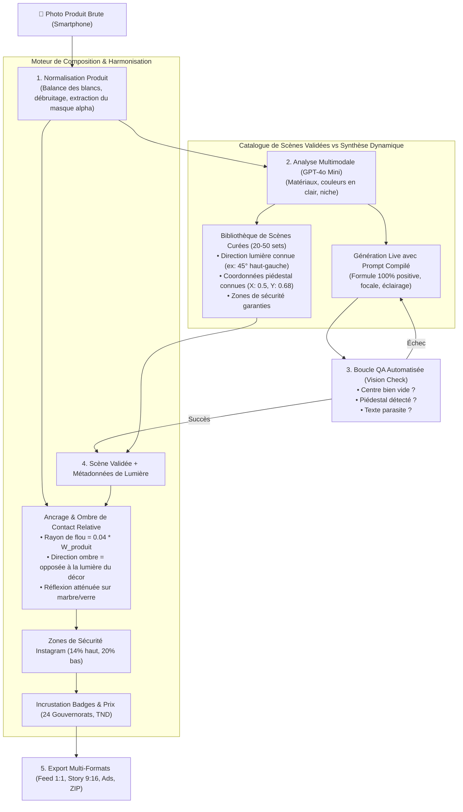

# 📐 Architecture Système & Ingénierie des Prompts — Adora AI (V2 Révisée)

> **Spécification Technique & Pipeline de Production** : Génération de décors studio e-commerce sans hallucinations, ancrage physique du produit réel, boucle de validation QA automatisée et composition multi-formats pour le marché tunisien.

---

## 1. Principes Fondamentaux & Règles de Production

### 1.1 Le Piège des Prompts Négatifs ("No bottles, no text")
Sur les modèles de diffusion récents (**DALL-E 3, gpt-image-1/2, Flux**), il n'existe pas de canal d'inférence de prompt négatif natif comme sur Stable Diffusion 1.5.
> ⚠️ **Constat empirique** : Écrire *"no bottles, no logos, no text"* active les tokens sémantiques associés ("bottle", "text") et **incite l'IA à en dessiner**.
* **Règle absolue d'Adora** : Décrire l'état d'arrivée de façon **100% positive** :  
  `"The central pedestal top surface is completely vacant, pristine, matte and polished, smoothly awaiting an object. Clean seamless solid background."`

### 1.2 Réalités Géographiques & Culturelles (Tunisie)
* **24 Gouvernorats** : La Tunisie compte exactement **24 gouvernorats** (58 correspond aux wilayas d'Algérie). Utiliser obligatoirement : *"Livraison sur toute la Tunisie (24 gouvernorats)"*.
* **Darija Authentique** : Remplacer les calques artificiels par des expressions naturelles tunisiennes :
  * *"Khlas and el livrison"* ou *"El khlass waqt el livri"* (Paiement à la livraison).
  * *"Weslet el commande jeyba m3aha el force"* (Nouveauté en stock).
* **Vérification Marchand** : Les mentions de type *"100% Original / Certifié"* ne sont appliquées que si le commerçant les a explicitement validées.

---

## 2. Architecture Globale du Pipeline (Workflow V2)



---

## 3. Formule de Prompt Positif en 6 Couches

Au lieu de mots creux ("8k", "Hasselblad") ou d'exclusions négatives, la formule se concentre sur les **lois physiques de la lumière et des matériaux** :

$$\text{Prompt} = [\text{Type de Décor}] + [\text{Surface d'Accueil Vacante}] + [\text{Physique de la Lumière}] + [\text{Perspective Caméra}] + [\text{Atmosphère & Arrière-plan}] + [\text{Zones de Sécurité Format}]$$

### Spécification des 6 Couches

| Couche | Nom | Paramètres Précis | Rendu |
| :--- | :--- | :--- | :--- |
| **L1** | **Support d'Accueil** | Surface, matière, géométrie | `Empty minimalist circular travertine stone pedestal, matte polished surface` |
| **L2** | **Vacance Absolue** | Déclaration positive de vacance | `The pedestal top surface is completely vacant, pristine, smooth, awaiting an object` |
| **L3** | **Lumière Directionnelle** | Source, angle, diffusion | `Directional softbox key light from upper-left at 45 degrees, gentle diffuse fill light, clean contact falloff` |
| **L4** | **Perspective & Élévation** | Hauteur d'angle contrôlée | `Camera positioned at eye-level 15 degrees elevation, razor-sharp focus on the pedestal` |
| **L5** | **Atmosphère de Contexte** | Arrière-plan flou de niche | `Modern architectural blurred background, soft natural bokeh, organic ambient gradient` |
| **L6** | **Cadrage & Safe Zones** | Format mobile vs feed | `Vertical 9:16 composition, generous clear space in the upper 14% and lower 20%` |

---

## 4. Bibliothèque de Scènes Prédéfinies avec Métadonnées Déterministes

Pour diviser la latence par 5, réduire le coût API à 0 DT pour le décor et garantir un réalisme mathématique des ombres, le SaaS s'appuie sur une bibliothèque de scènes pré-générées :

```typescript
export interface StagingScene {
  id: string;
  name: string;
  niche: 'fitness' | 'cosmetics' | 'fashion' | 'watches' | 'general';
  aspectRatio: '1:1' | '9:16' | '3:2';
  backgroundUrl: string;
  
  // Métadonnées physiques pour le calcul d'ombrage automatique
  lighting: {
    keyLightDirection: 'top-left' | 'top-right' | 'overhead';
    keyLightAngleDeg: number;    // Ex: 45°
    ambientLightIntensity: number; // 0.1 à 1.0
    colorTemperatureK: number;   // Ex: 5600K
  };

  // Coordonnées d'ancrage normalisées du piédestal (0.0 à 1.0)
  pedestalAnchor: {
    centerX: number;             // 0.5 = centré horizontalement
    surfaceY: number;            // 0.68 = niveau où la base du produit touche le sol
    maxProductWidthRatio: number; // 0.45 = le produit ne doit pas dépasser 45% de la largeur
    isGlossy: boolean;           // Si true: appliquer un miroir atténué
  };

  // Zones de sécurité UI
  safeZones: {
    topPaddingPercent: number;    // 14% pour Instagram Story
    bottomPaddingPercent: number; // 20% pour le footer Story
  };
}
```

---

## 5. Gestion Réaliste des Ombres & Réflexions (Post-Production)

### 5.1 Ombre de Contact Relative (Ambient Occlusion)
* **Erreur courante** : Définir un flou fixe de 4px, qui devient invisible sur une image 1536px ou baveux sur une image 512px.
* **Formule Adora relative** :
  $$\text{Blur}_{\text{contact}} = W_{\text{produit}} \times 0.035$$
  $$\text{Hauteur}_{\text{contact}} = H_{\text{produit}} \times 0.04$$
* **Couleur** : Noir bleuté profond (`rgba(10, 14, 24, 0.75)`), avec dégradé radial étiré.

### 5.2 Ombre Portée Dérivée de la Scène (Cast Shadow)
* L'angle de l'ombre portée n'est plus "deviné à 35°", mais calculé directement depuis `scene.lighting.keyLightAngleDeg`.
* Si la lumière vient de `top-left` à 45°, l'ombre est projetée vers le `bottom-right` à 135°.

### 5.3 Réflexion Spéculaire pour les Surfaces Glossy
* Sur marbre ou acrylique, une copie inversée verticalement du produit est insérée sous la ligne de contact (`scaleY(-1)`), avec un masque de dégradé linéaire décroissant (opacité 25% $\to$ 0% sur 30% de la hauteur du produit).

---

## 6. Boucle QA de Contrôle Qualité Automatisé

Lors d'une génération en direct avec l'API OpenAI, le serveur exécute un contrôle qualité rapide (via `gpt-4o-mini`, detail `low` = 85 tokens) :

```typescript
interface QaInspection {
  vacantCenter: boolean;        // Le centre est-il bien vide sans faux flacon ?
  pedestalDetected: boolean;    // Le support est-il bien visible ?
  noParasiticText: boolean;     // Y a-t-il absence de texte halluciné ?
  passed: boolean;
}
```

* Si `passed === true` : L'image est envoyée au compositeur.
* Si `passed === false` : Le serveur relance **1 tentative automatique unique** avec un prompt renforcé en accentuation de surface vacante (`"Entirely empty smooth surface, vacant stage"`).

---

## 7. Respect Strict des Zones de Sécurité (Format-Aware Layouts)

### Instagram Stories (Format 9:16)
* **Zone Supérieure Interdite (0% à 14%)** : Réservée au nom de profil, photo d'avatar, bouton de fermeture et barres de progression des stories. Aucun badge ni texte important ne doit s'y trouver.
* **Zone Inférieure Interdite (80% à 100%)** : Réservée au champ "Envoyer un message", stickers d'interaction et barre de navigation.
* **Zone Utile (14% à 80%)** : Espace où se déploient le piédestal, le produit, le prix et les badges de conversion.
